# Kafka Manager / CDC Pipeline Manager

MySQL → Debezium → Kafka → ClickHouse, and the control room I built to run it.

A write-up of a real-time change data capture pipeline I designed and run in production, plus small reference snippets I wrote for this repo. The production code is private; everything here is a clean re-implementation to show the approach.

## Context
The analytics side needed live data from a busy transactional MySQL system: customer, CRM and transactional tables, 200+ of them. The older replication was losing records and nobody could say why. I redesigned it so the numbers could be trusted, across Local/dev, staging and production.

## Requirements
- **Throughput:** ~11k changed rows/min sustained, peaks above 28k, ~80% updates, 220+ consumers
- **Zero loss:** no skipped events. Failures stop the pipeline loudly.
- **HA:** survive losing a broker, a Connect worker or a consumer

## Architecture
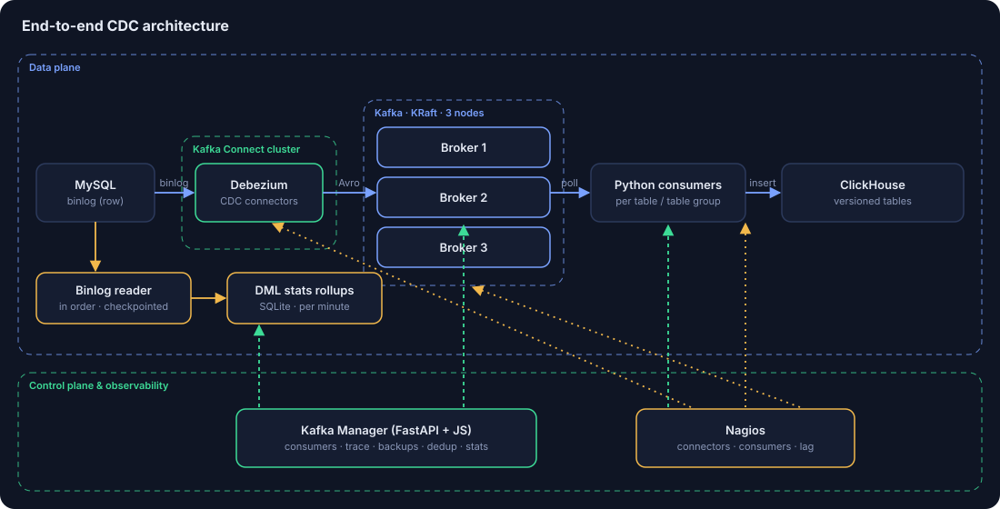

## High availability and failover
All three KRaft nodes run as controller and broker, so the quorum survives losing one. Topics are replicated and writes only count once the in-sync replicas have them, so leadership moves to an up-to-date follower. Connect runs distributed: a lost worker's Debezium tasks rebalance and resume from the stored binlog position. Consumers fail over through their group and resume from the last committed offset, which is always a ClickHouse-confirmed batch. Planned recycles go in batches with hold times.

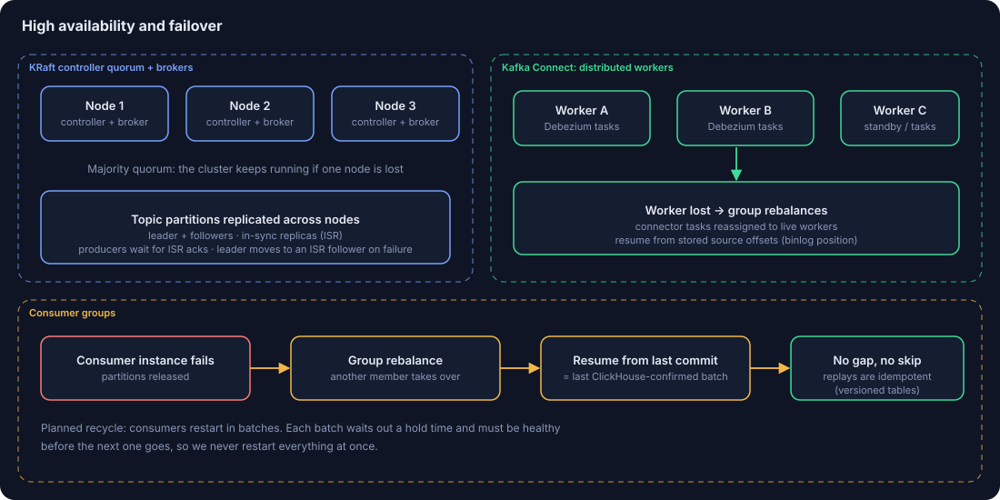

## Delivery guarantee
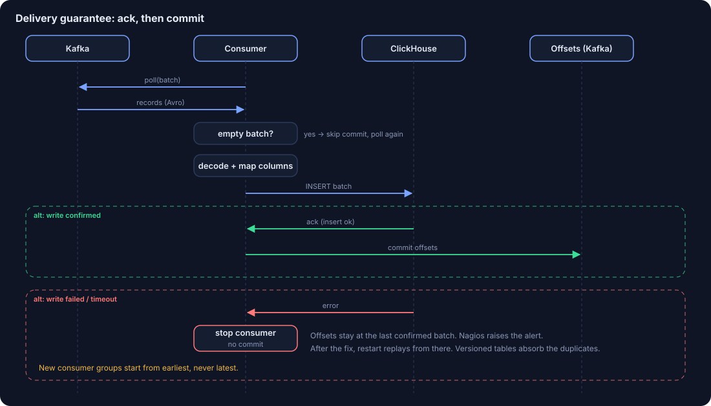

## Promotion
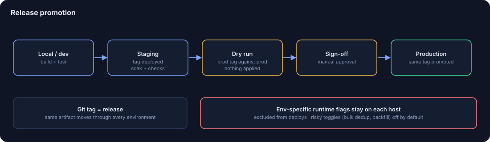

## ClickHouse warehouse
Topic layers go raw CDC → processed analytics → BI streaming. Consumers write into ReplacingMergeTree-style versioned tables, dedup uses lightweight deletes, and new source columns are added automatically. The warehouse serves real-time operational reporting and customer activity analytics. Data also goes out through APIs, webhooks, SFTP/FTP and Kafka sinks.

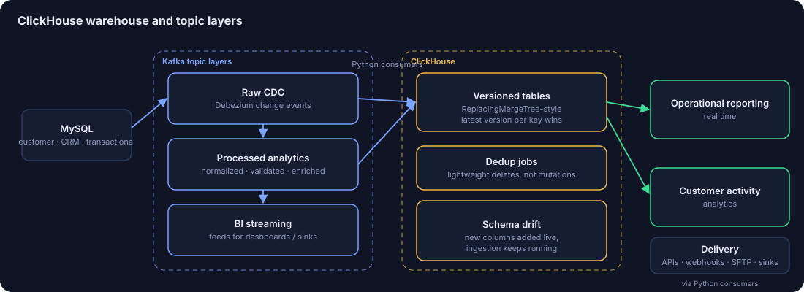

## Observability
Consumer lag, binlog headroom (how long until MySQL purges what a stalled connector still needs), exact per-table per-minute DML from the binlog, and Nagios alerts on connectors, consumers and lag.

## Failure modes
| What breaks | What happens |
|---|---|
| Broker down | Quorum holds, leadership moves to in-sync replicas |
| Connect worker down | Tasks rebalance, resume from stored binlog position |
| Consumer crash | Group rebalance, resume from last confirmed offset |
| ClickHouse write fails | Consumer stops, no commit, Nagios alert |
| New MySQL column | Added to ClickHouse, ingestion keeps running |
| Connector stalled | Binlog headroom shows the recovery window |
| Suspected missing rows | Id-gap audit finds exact ids and the owning consumer |

### Same thing in mermaid
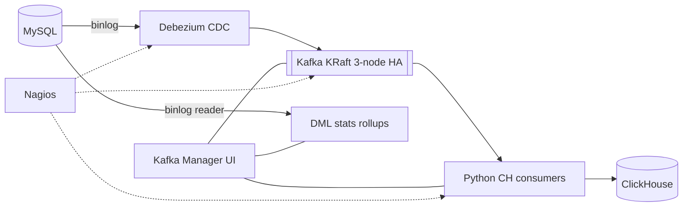

## Numbers
| | |
|---|---|
| Replicated tables | 200+ (217 audited, ~190 active) |
| Sustained load | ~11k changed rows/min |
| Peak | 28k+ rows/min |
| Consumers | 220+ |
| DML mix | ~80% updates, ~20% inserts |
| Environments | Local/dev, staging, production |

## Design decisions and trade-offs
| Decision | Trade-off |
|---|---|
| Commit after ClickHouse ack | Possible re-writes after a crash, absorbed by versioned tables |
| Failed batch stops consumer | Table pauses until someone looks. Lag alerts cover it. |
| New groups from earliest | Slower first catch-up |
| Lightweight-delete dedup | Separate opt-in job |
| Bounded id-gap audit | A full audit takes time, by design |

- **Zero event skipping.** Offsets are committed only after ClickHouse confirms the write. A failed batch stops the consumer. New consumer groups start from earliest. Empty batches never count as success. See [`examples/ack_then_commit.py`](examples/ack_then_commit.py).
- **Exact DML metrics.** Insert/update/delete counts come from reading the binlog in order with checkpoints, so they're exact and resumable.
- **Recycling in batches.** Consumers restart in groups with hold times, not all at once.
- **Gated releases.** Git tags promote Local → staging → prod. Dry run and sign-off are required before prod. Env-specific runtime flags are excluded from deploys.
- **Low-load id-gap audit.** ~20k-id PK buckets, one bounded query at a time with time limits and pauses. Safe on production. See [`examples/id_gap_audit.py`](examples/id_gap_audit.py).
- **Schema drift.** New source columns are added to ClickHouse without stopping ingestion.
- **Risky toggles off by default.** Bulk dedup and backfill never switch themselves on.

## Kafka Manager UI (the main thing)
FastAPI backend, plain JS front end. The team uses it every day across dev, staging and prod.

- **Consumers:** start, stop and recycle with live status. Recycling goes in batches with hold times.
- **Trace:** scans every partition of a topic for a key or record id.
- **Backups:** topic backups with retention presets.
- **Dedup:** jobs use ClickHouse lightweight deletes instead of mutations.
- **Stats:** per-minute insert/update/delete rollups per table from my own binlog reader, lag, binlog headroom, baseline vs now, hottest table, top 5/10/20 charts.

### Screenshots
Some names are blurred.

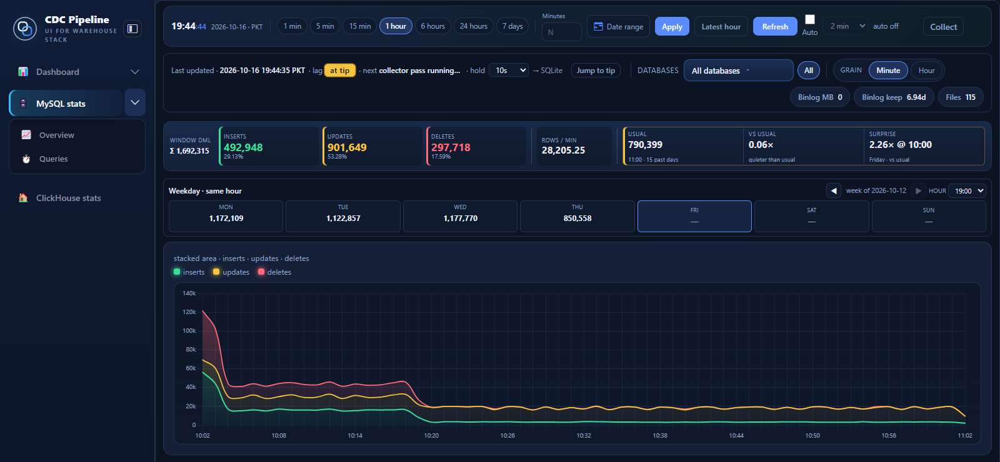

| | |
|---|---|
| 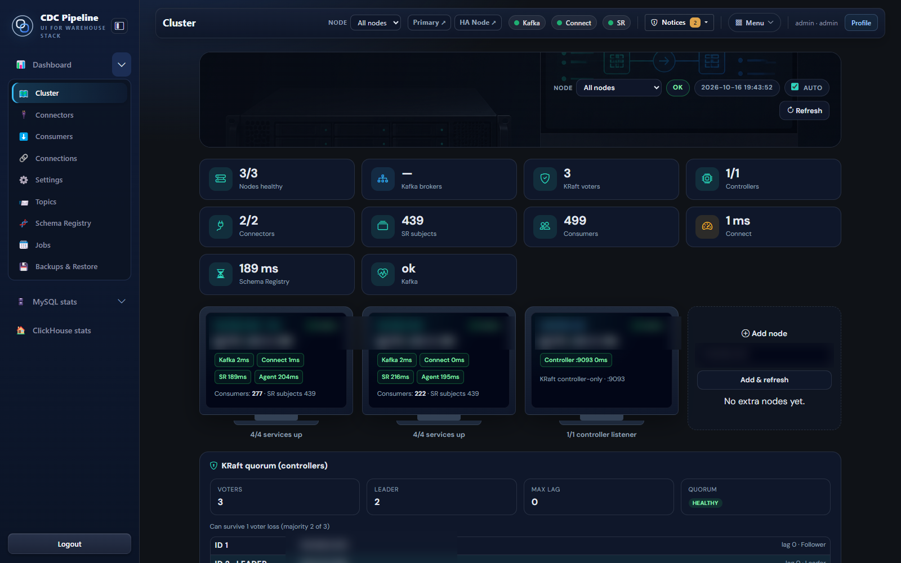 Cluster and KRaft quorum | 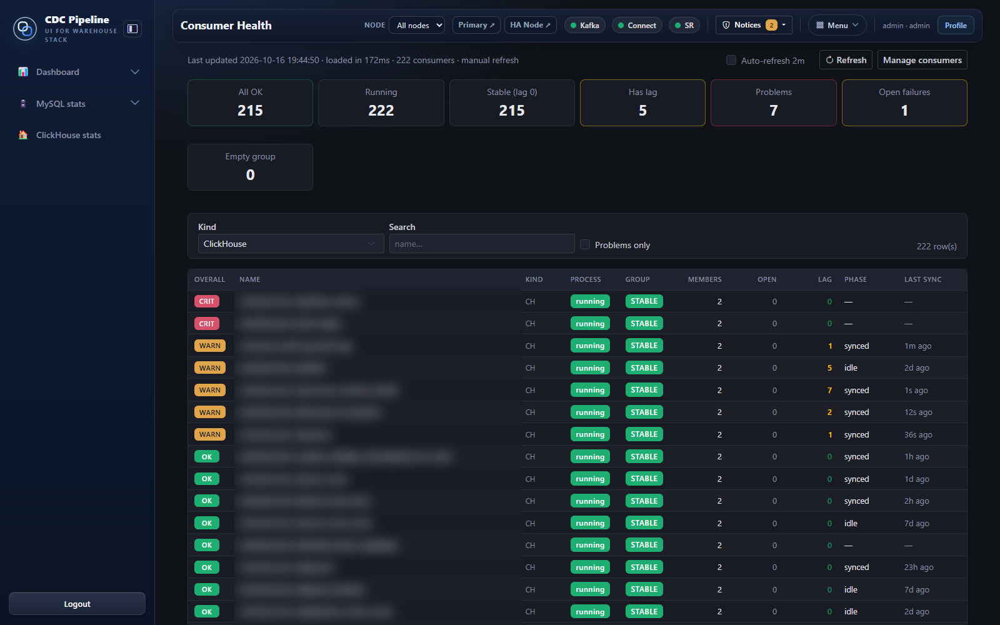 Consumer health |
| 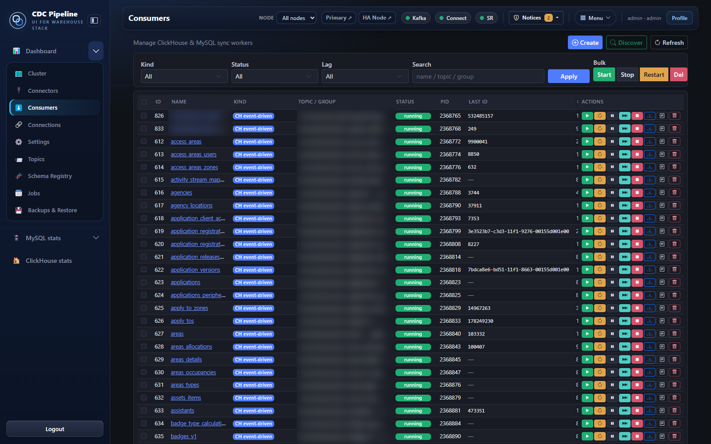 Consumers | 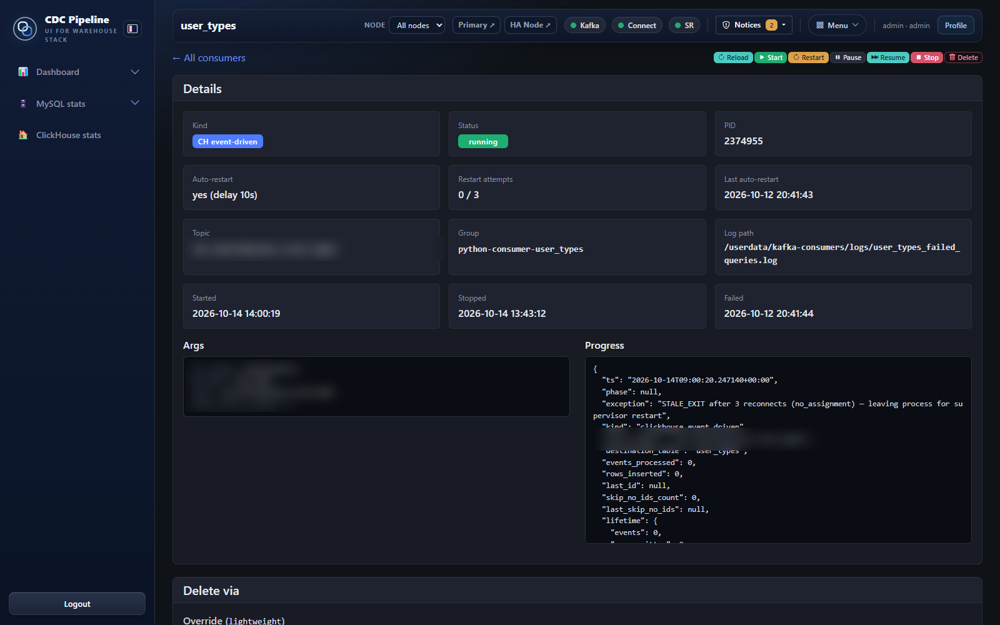 Consumer detail |
| 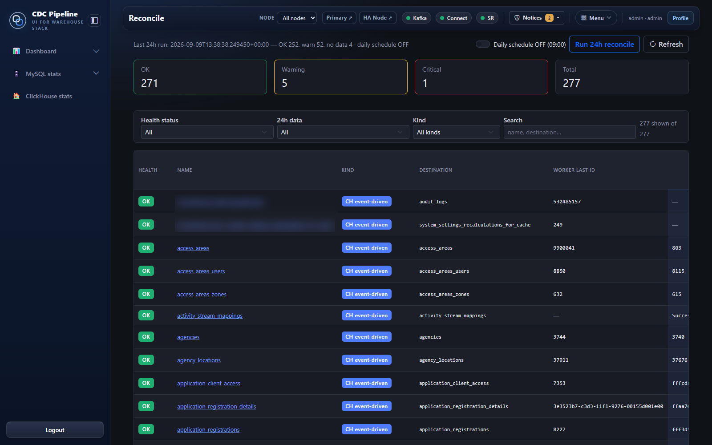 Reconcile | 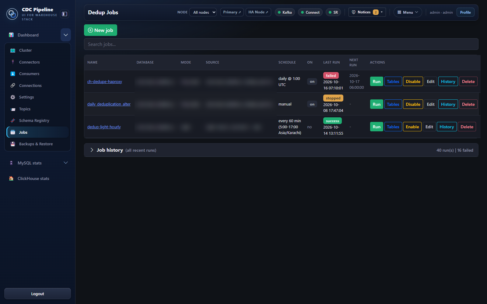 Dedup jobs |
| 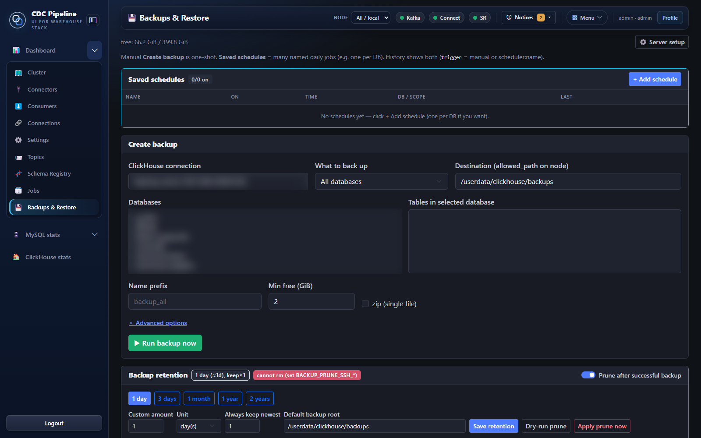 Backups | |

## Outcomes
- Found and fixed the root causes of historical missing records: commit-before-ack, latest-offset resets, empty-batch commits.
- Post-fix audit: no missing ids in almost every table; remaining gaps trace to specific consumers.
- Real-time per-table load visibility for faster triage.
- Repeatable, gated deploys across three environments.

More detail in [docs/](docs/), including [a tour of every Kafka Manager tab](docs/tabs.md).

---
Built by Muhammad Danish Ishfaq (Danish). Nearly 9 years in data engineering, MS Computer Science from the University of Eastern Finland. daneshrana45@gmail.com
