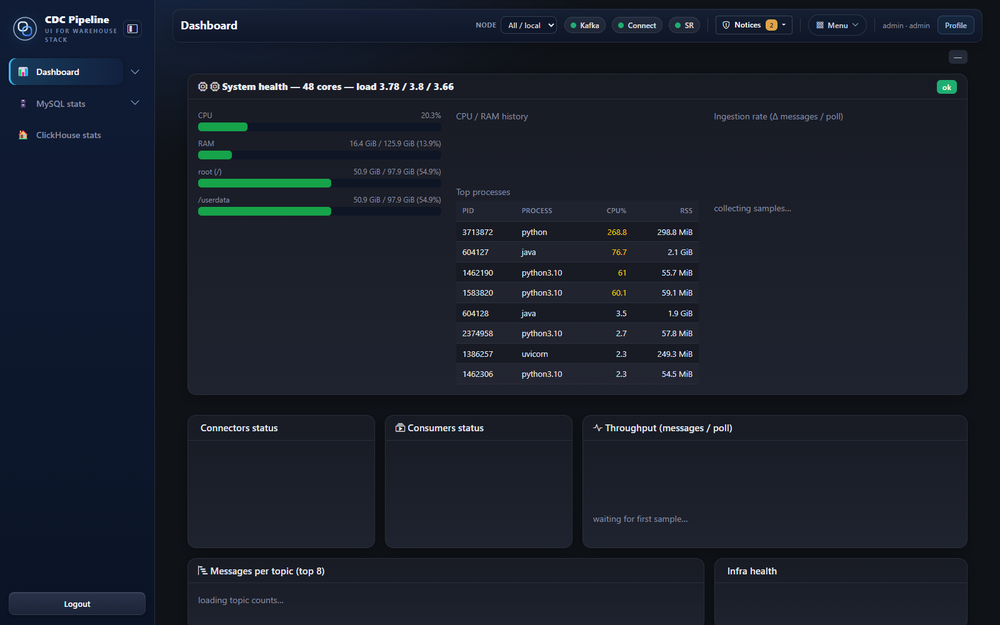
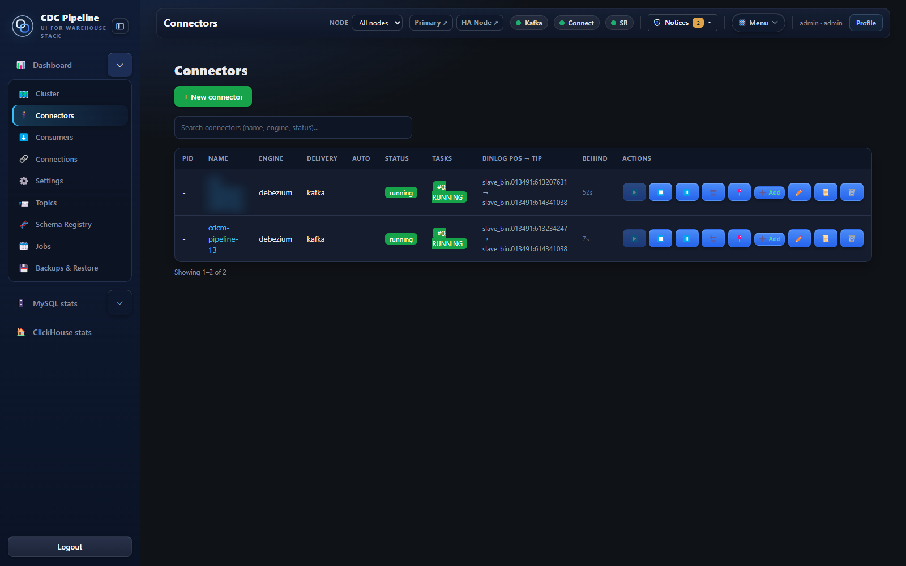
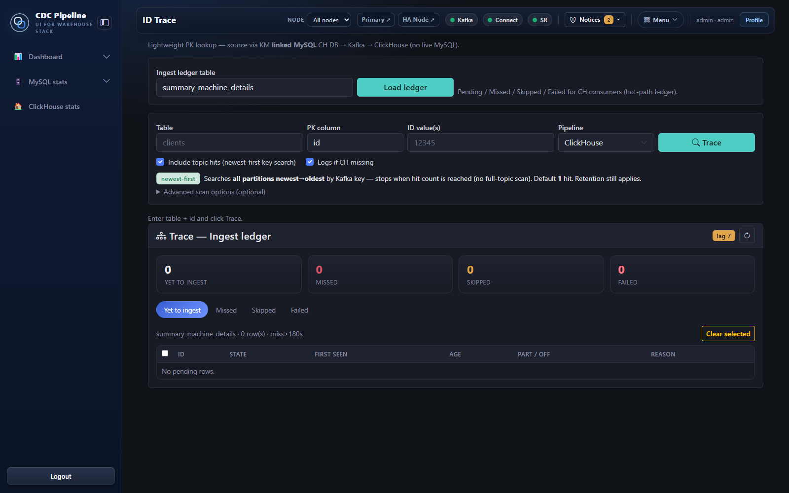
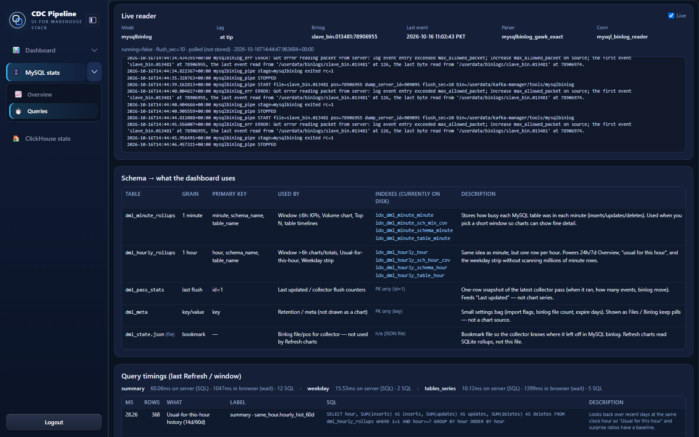

# Kafka Manager: a tour of every tab

Kafka Manager is the control plane I built for the CDC pipeline. It's a FastAPI backend with a plain JS front end, and the top bar shows the health of Kafka, Connect and Schema Registry on every page. These are real screenshots. Internal IPs and company table names are blurred.

## Dashboard
The landing page. It shows host health (CPU, RAM, disk), top processes, connector and consumer status, throughput in messages per poll, and messages per topic. The charts fill in after a few polls, which is why they're empty in this capture.

## Connectors
Every Debezium connector, with its status and tasks, and the binlog position next to the binlog tip so I can see how far behind it is. From here I can start, pause, restart, edit or remove a connector.

## Consumers
One Python worker per table or table group. The list shows the kind, topic and group, process id and last id written. Filters plus bulk start, stop and restart let me recycle consumers in batches instead of all at once.

## Consumer detail
Everything about one consumer: status, PID, auto-restart policy and attempts, topic, group, log path, start/stop/fail times, launch args and live progress as JSON. The example shows a consumer that exited after repeated reconnects and handed itself back to the supervisor. It stopped instead of skipping data.

## Trace
Finds a record by primary key. It searches every partition of the topic newest-first by Kafka key and stops at the first hit, so it never does a full-topic scan. It also checks whether ClickHouse has the row. The ingest ledger shows ids that are yet to ingest, missed, skipped or failed for each table.

## Backups & Restore
One-off and scheduled ClickHouse backups by database or table, a minimum free-space check, retention presets (1 day to 2 years), and a dry-run prune before anything is deleted.

## Jobs (dedup)
Scheduled dedup jobs. The light hourly job uses lightweight deletes with a precheck instead of mutations. Each job keeps its run history. Bulk jobs stay disabled until someone turns them on.

## MySQL stats: overview
Exact DML load from my own binlog reader. It shows inserts, updates and deletes for any window, rows per minute, usual-vs-now for this hour and weekday, a stacked activity chart, and top 5/10/20 tables with drill-down.

## MySQL stats: queries
The plumbing behind the stats page. It shows the live binlog reader (lag, binlog file and position, last event) with its log, the SQLite rollup tables and indexes the dashboard reads, and timings for every query a refresh runs.

## Cluster
The 3-node setup at a glance: node health, Kafka brokers, KRaft voters and controller, connectors, Schema Registry subjects, consumers, and latency per service. The quorum panel shows voters, leader, max lag and that it can survive losing one voter.

## Reconcile
A daily check of each table against ClickHouse. Every consumer gets OK, warning or critical, with the destination table and the last id the worker wrote.

## Consumer health
The page I check first. It covers all consumers with process state, group state, members, open failures, lag, sync phase and last sync. It sorts problems to the top and has a "problems only" filter.

